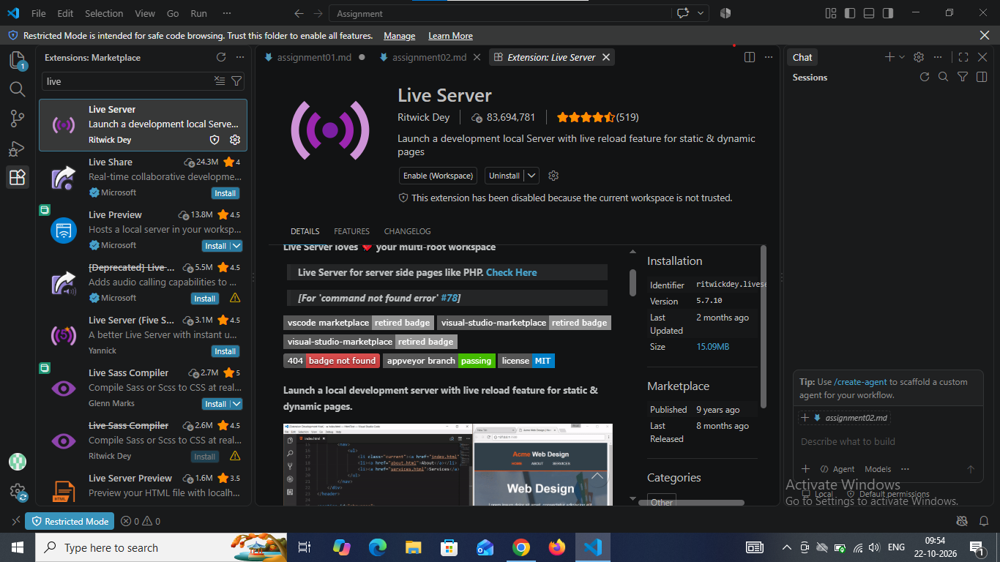

Task 2: Install VS Code, Node.js, and Live Server ?
Step 1: Install Visual Studio Code
Open your web browser.
Visit the official website: Visual Studio Code⁠
Download the version suitable for your operating system.
Open the downloaded installer.
Follow the installation instructions.
Finish the installation and open VS Code.
Step 2: Install Node.js
Open your browser.
Visit the official website: Node.js⁠
Download an appropriate LTS (Long-Term Support) version.
Run the installer.
Follow the installation instructions, keeping the default options unless you have a reason to change them.
Complete the installation.
Now verify the installation.
Open VS Code.
Select Terminal → New Terminal from the top menu.
Type the following command:node -v
Press Enter.
Type:npm -v
Press Enter.
Check: Both commands should display version numbers. This confirms that Node.js and npm are available in your terminal.
Step 3 : install live server
Click the Install button.
Wait for the installation to finish.
Once installed, the button will change to indicate that the extension is installed.
